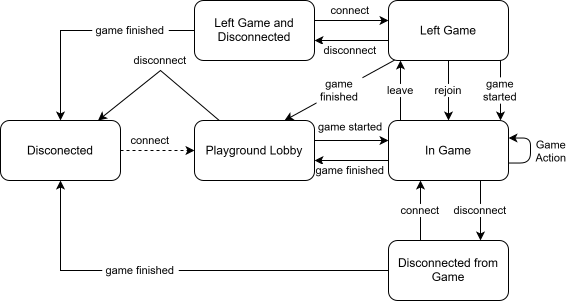

# Player State

- A player is initialized when the `connect` command is sent, shown as a dashed line in the diagram below.
- The only component that doesn't have the same name in the implementation is the `Playground Lobby` that is only named `InLobby`.
- Transitions not shown are unsupported and should never happen. For example, a player in a game can't be added to another.
